<p align="center"><a href="https://galasulin.github.io/apos4-scroll-landing/">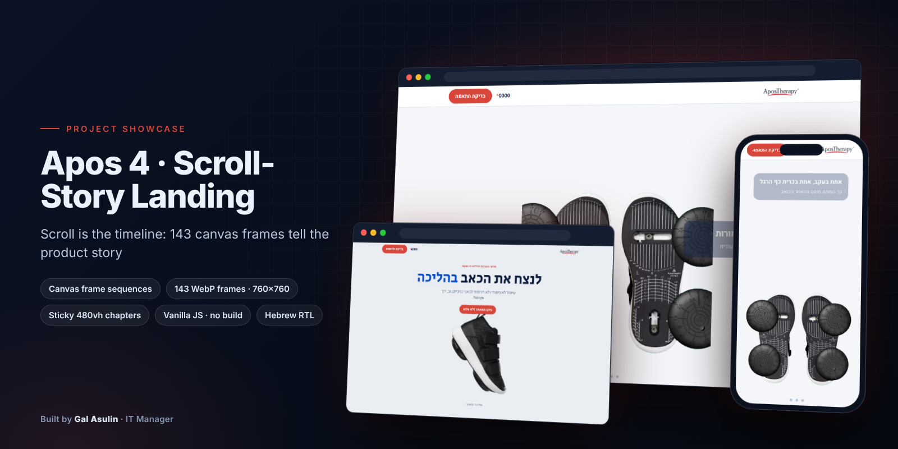</a></p>

<div align="center">

# Apos 4 · דף נחיתה שמספר סיפור בגלילה

**דף השקה למערכת הליכה רפואית, שבו פס הגלילה הוא ציר הזמן: 143 פריימים על canvas מסובבים את הנעל, מפרקים את היחידות ומחברים אותן בחזרה.**

🇬🇧 [English](README.md) · 🇮🇱 עברית

[](https://galasulin.github.io/apos4-scroll-landing/)


<br>


[דמו חי](https://galasulin.github.io/apos4-scroll-landing/) · [מסכים](#מסכים) · [ארכיטקטורה](#ארכיטקטורה) · [טכני](#פרמטרים-טכניים)

<br>

<a href="https://galasulin.github.io/apos4-scroll-landing/">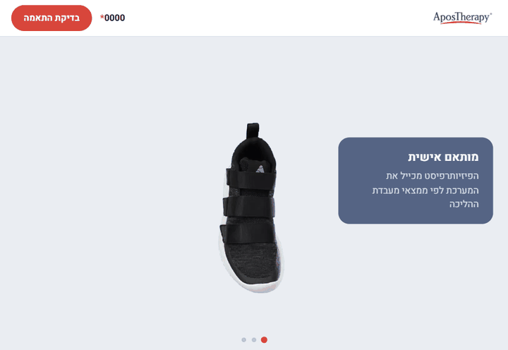</a>

<sub>בדף החי גוללים לאט: הדף עצמו הוא האנימציה.</sub>

</div>

<div dir="rtl" align="right">

> **מאגר תצוגה.** עותק סטטי ומנוקה של דף נחיתה שרץ בפרודקשן על הדומיין של החברה. הוסרו ממנו מנהל התגים, החיבור ל-CRM לקליטת לידים, תוסף הנגישות החיצוני וכל מספרי הטלפון האמיתיים. הטופס עדיין מבצע ולידציה, אבל לא שולח כלום: שליחה תקינה מציגה רק הודעת הדגמה. פירוט מלא ב[פרטיות והיקף](#פרטיות-והיקף).

## במבט מהיר

| | |
|---|---|
| **סוג** | דף השקת מוצר וקליטת לידים |
| **סטטוס** | חי בפרודקשן על הדומיין של החברה · הריפו הזה הוא העותק המנוקה |
| **סטאק** | HTML5 · CSS · JavaScript נקי · `<canvas>` · WebP |
| **התפקיד שלי** | קונספט, עיצוב, פיתוח Front-end וחיבור לפרודקשן |
| **דמו חי** | [galasulin.github.io/apos4-scroll-landing](https://galasulin.github.io/apos4-scroll-landing/) |
| **שפות** | ממשק בעברית (RTL) · תיעוד באנגלית ובעברית |

## מסכים

<table>
  <tr>
    <td width="33%"><a href="assets/desktop-hero.png">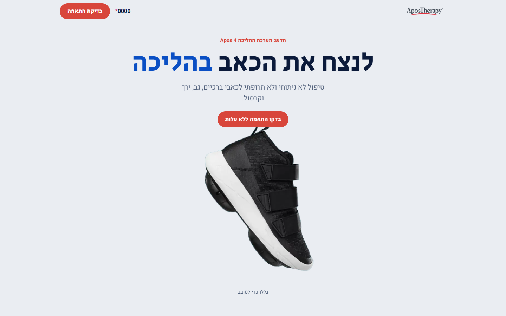</a><br><sub><b>ראש הדף</b> · הפריים הראשון של הסיבוב מתחת לכותרת</sub></td>
    <td width="33%"><a href="assets/scroll-1-attached.png">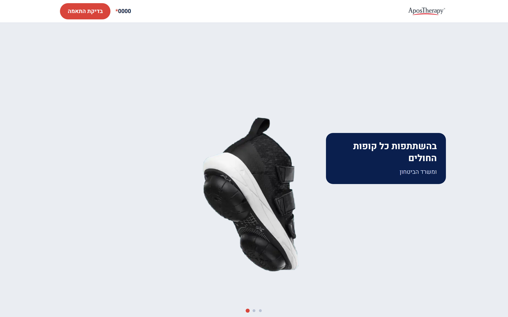</a><br><sub><b>1 · מחובר</b> · המערכת כולה על הנעל, המסר האחרון של הסיבוב במלואו</sub></td>
    <td width="33%"><a href="assets/scroll-2-detached.png">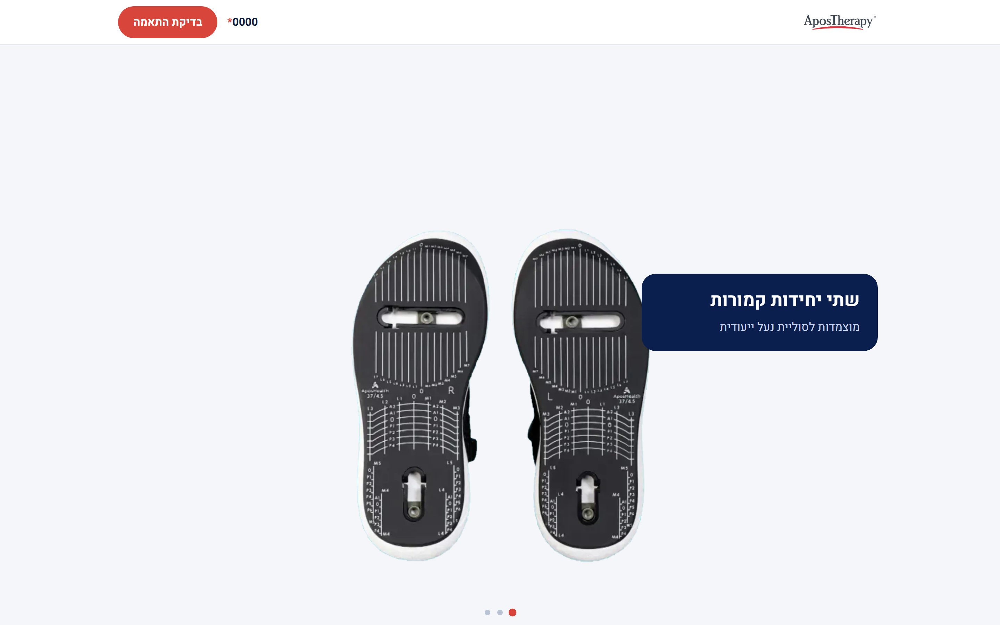</a><br><sub><b>2 · מפורק</b> · היחידות מנותקות לגמרי, סוליה חשופה ורשת הכיול, הכיתוב במלואו</sub></td>
  </tr>
  <tr>
    <td width="33%"><a href="assets/scroll-3-snapping.png">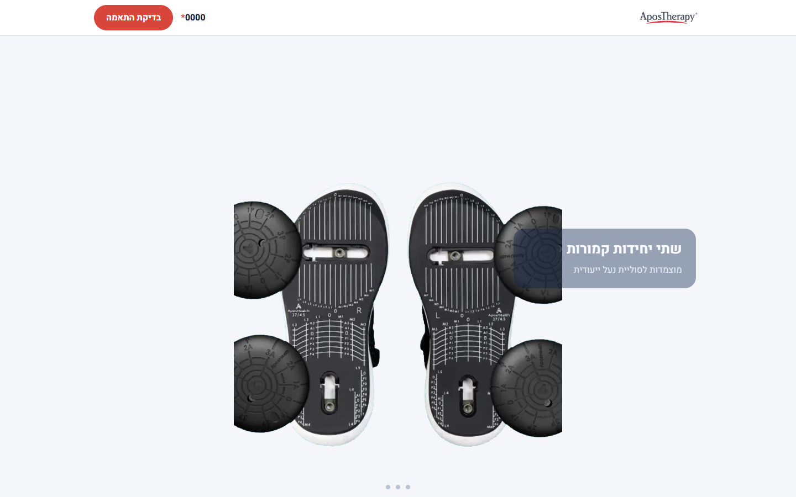</a><br><sub><b>3 · מתחבר</b> · היחידות נכנסות מהצדדים</sub></td>
    <td width="33%"><a href="assets/scroll-4-reattached.png">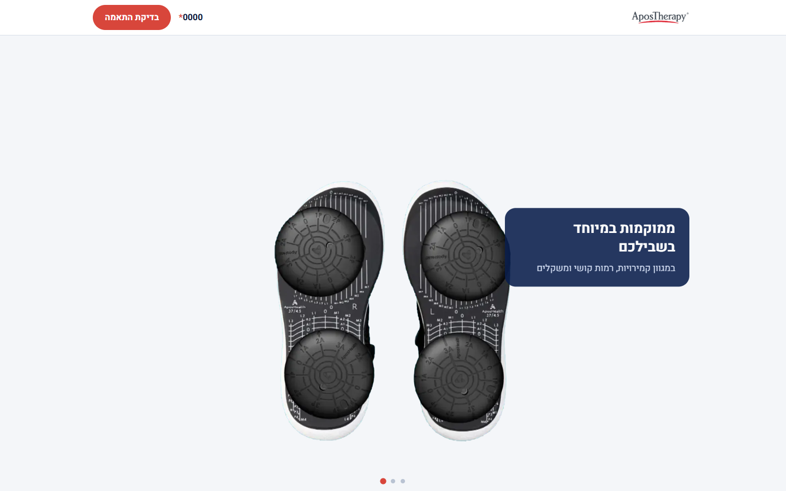</a><br><sub><b>4 · נצמד חזרה</b> · ארבע היחידות במקומן, המסר האחרון</sub></td>
    <td width="33%"><a href="assets/desktop-proof.png">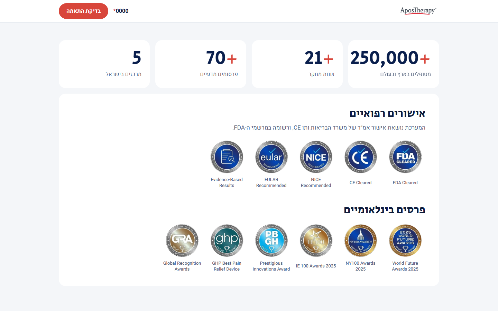</a><br><sub><b>הוכחות</b> · מונים, אישורים ותגי פרסים</sub></td>
  </tr>
  <tr>
    <td width="33%"><a href="assets/desktop-form-demo.png">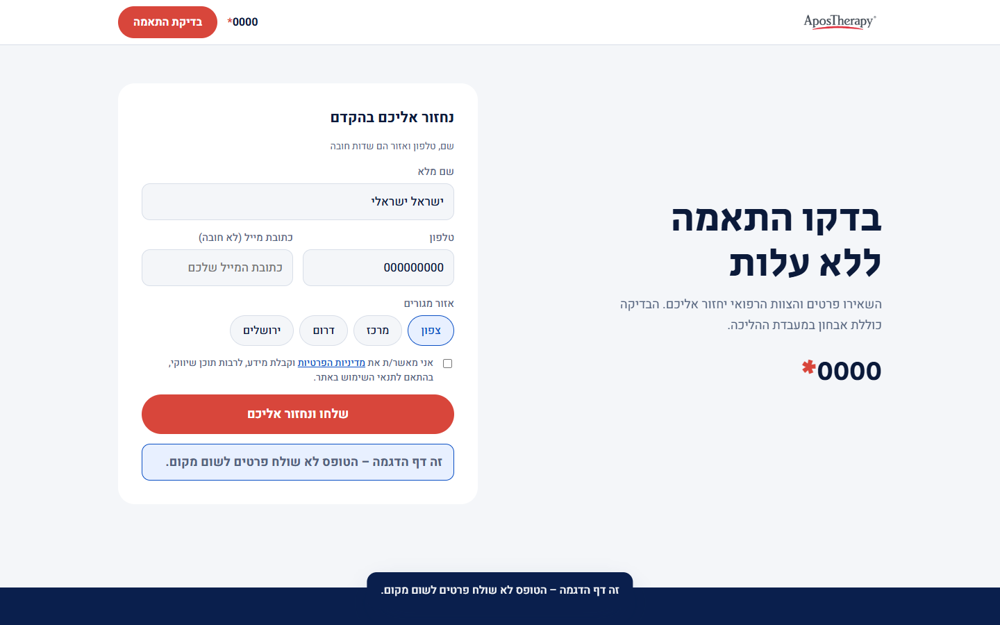</a><br><sub><b>טופס (הדגמה)</b> · ולידציה של פרודקשן, בלי שליחה</sub></td>
    <td width="33%" align="center"><a href="assets/mobile.png">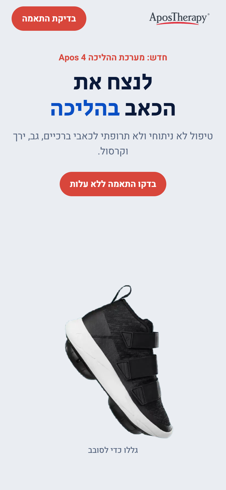</a><br><sub><b>מובייל</b> · ראש הדף</sub></td>
    <td width="33%" align="center"><a href="assets/mobile-pods.png">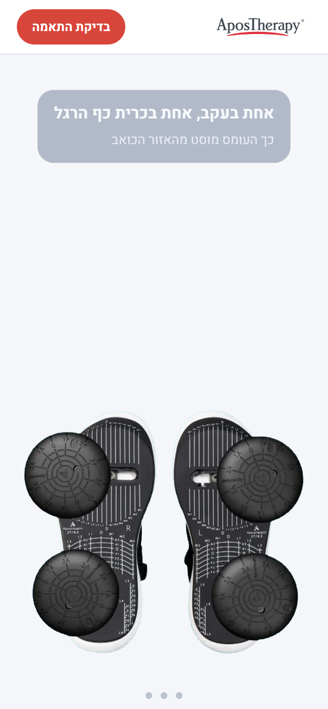</a><br><sub><b>מובייל</b> · פרק היחידות, הכיתובים מעל הנעל</sub></td>
  </tr>
</table>

## מה זה

דף ההשקה של **Apos 4**, הדור החדש של מערכת ההליכה של אפוסתרפיה: נעל עם שתי יחידות קמורות מתחת לכל סוליה, שמסיטות עומס מהמפרק הכואב. הסיפור של המוצר הוא *מה שמתחת לרגל*, ולכן הדף מספר אותו דרך המוצר עצמו ולא דרך פסקאות.

גוללים, והדף מתנגן כמו סרט שהגולש שולט בו. הנעל מסתובבת סיבוב מלא. המצלמה יורדת אל הסוליה, היחידות לא שם, ורשת הכיול חשופה. ממשיכים לגלול, וארבע היחידות נכנסות ונצמדות, יחידה בעקב ויחידה בכרית כף הרגל בכל נעל. גוללים חזרה למעלה, והן יורדות שוב. אחר כך רצף "איך זה עובד" צמוד, הוכחות, שתי הגרסאות וטופס לידים אחד.

## יכולות מרכזיות

**סיפור בגלילה**
- שני פרקים מוצמדים (`#ch-rotate`, `#ch-pods`), כל אחד בגובה `480vh`, עם במה ב-`position: sticky` בגובה `100svh`. הדפדפן גולל כרגיל: בלי חטיפת גלילה ובלי השתלטות על הגלגלת.
- פרק 1: סיבוב מלא של הנעל, 56 פריימים. לידה עולים שלושה מסרים: התאמה אישית, בבית בתוך השגרה, בהשתתפות כל קופות החולים.
- פרק 2: הסוליה, 87 פריימים. היחידות יורדות, הרשת נחשפת, והיחידות חוזרות. גלילה למעלה הופכת את התנועה.

**מנוע רצף הפריימים**
- פריימים של WebP שקוף בגודל 760 × 760, מצוירים על `<canvas>` באותו גודל.
- סדר טעינה: פריים 1 נטען מראש עם `<link rel="preload" fetchpriority="high">`; הפריים הראשון והאחרון מיד; אחרי 300 מילישניות כל פריים רביעי, ואז השאר. אפשר לגרור את הרצף כמעט מהרגע הראשון.
- אם פריים עוד לא פוענח, מצויר הפריים הטעון הקרוב ביותר, כך שהקנבס אף פעם לא ריק.

**תנועה בלי ספרייה**
- ההתקדמות המוצגת מתקרבת בהדרגה להתקדמות הגלילה האמיתית (`cur += (target - cur) * 0.12`) בתוך לולאת `requestAnimationFrame` שרצה רק כל עוד משהו זז, ואז נעצרת.
- כל כיתוב מצהיר על פלח הפרק שלו (`data-range="0.30 0.55"`). פונקציה אחת מעמעמת, מגדילה ומזיזה את כולם מאותו ערך התקדמות, ופס נקודות מסמן את המסר הפעיל.
- הכיתובים ממוקמים מהנעל החוצה (משתני CSS ‏`--shoe` ו-`--beside`) ולא משולי המסך. בנייד הם עוברים מעל הנעל.

**מקטעי תוכן**
- "איך זה עובד": תמונה צמודה שמתחלפת בעמעום כשכל שלב חוצה את אמצע המסך (`IntersectionObserver` עם `rootMargin: -45% 0px -45% 0px`). מתחת ל-860 פיקסלים התמונה עוברת לתוך כל שלב.
- הוכחות: ארבעה מספרים שנספרים כלפי מעלה, 5 תגי אישורים רפואיים ו-6 תגי פרסים.
- שתי גרסאות (שרוכים / סקוטש) ותצוגה מפורקת של החלקים.

**טופס ונגישות**
- תוויות, `fieldset` / `legend` לאזור המגורים, שגיאות עם `aria-invalid` ו-`aria-describedby`, פוקוס עובר לשדה השגוי הראשון, מייל לא חובה, שדה מלכודת נסתר לבוטים, אזורי מגע של 44 פיקסלים.
- קישור דילוג לטופס, טבעת `:focus-visible` בולטת, `role="img"` ו-`aria-label` על שני הקנבסים, התחשבות ב-safe-area במכשירים עם מגרעת.
- `prefers-reduced-motion`: הפרקים מתכווצים לגובה רגיל, הקנבס מציג את מצב הסיום (יחידות מחוברות), כל הכיתובים גלויים, וחשיפות ומונים סטטיים.

## ארכיטקטורה

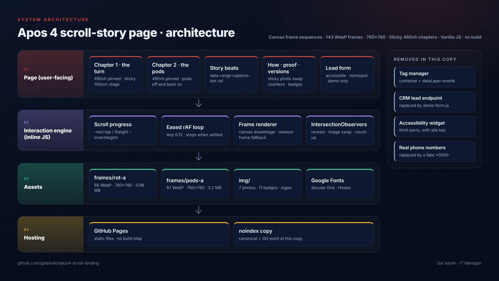

הדף הוא קובץ `index.html` סטטי אחד, עם CSS וסקריפט מנוע מוטמעים, ועוד `demo-form.js` קטן. אין framework ואין שלב build. אירוע גלילה או שינוי גודל רק "מניע" לולאת `requestAnimationFrame`. בכל tick היא קוראת את ההתקדמות של שני הפרקים המוצמדים מתוך `getBoundingClientRect()`, מתקרבת אליה בהדרגה, ממפה אותה למספר פריים בכל רצף, ומפעילה כל כיתוב שמצהיר על `data-range`. קבוצה נפרדת של `IntersectionObserver` מטפלת במקטעים הרגילים: חשיפות, החלפת התמונה הצמודה והמונים. הנכסים הם קבצים רגילים שמוגשים מ-GitHub Pages; השרת החיצוני היחיד הוא Google Fonts.

### זרימה

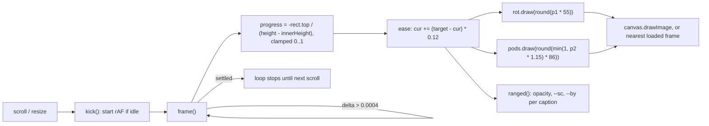

## פרמטרים טכניים

| פרמטר | ערך |
|---|---|
| מעטפת הדף | `index.html` ‏39,499 בייט (markup, ‏CSS מוטמע, מנוע מוטמע) · `demo-form.js` ‏3,843 בייט · `accessibility.html` ‏4,612 בייט |
| רצף הסיבוב (`frames/rot-a/`) | 56 פריימים · WebP עם שקיפות · 760 × 760 פיקסלים · 978,672 בייט בסך הכול (ממוצע 17.5KB) |
| רצף היחידות (`frames/pods-a/`) | 87 פריימים · WebP עם שקיפות · 760 × 760 פיקסלים · 3,212,190 בייט בסך הכול (ממוצע 36.9KB) |
| כל הפריימים | 143 פריימים · 4,190,862 בייט (כ-4.0MiB) |
| משקל הדף מנכסים עצמיים | 4,944,779 בייט (כ-4.7MiB): HTML, סקריפט הטופס, favicon, כל הפריימים, התמונות, התגים והלוגואים; 85% מזה פריימים. לא כולל פונטים ותמונת השיתוף |
| תמונות ותגים (`img/`) | 7 תמונות WebP ברוחב 1500 עד 1800 פיקסלים · 11 תגי WebP בגודל 240 × 240 שמוצגים ב-96 פיקסלים (80 ב-520 ומטה) · 2 לוגואים PNG · תמונת שיתוף JPEG ‏1200 × 630 |
| פרקים מוצמדים | 2 × `480vh` · במה צמודה `100vh` / `100svh` · גודל הקנבס `min(88vw, 66svh)` (‏`min(92vw, 52svh)` ב-760 ומטה) |
| החלקת גלילה | מקדם lerp ‏0.12 לפריים · סף עצירה 0.0004 · רצף היחידות מסתיים ב-87% מהפרק (`p × 1.15`) |
| עמעום כיתובים | `data-range` לכל כיתוב · כניסה ויציאה על פני 0.09 התקדמות · קנה מידה 0.95 ← 1 · הזזה של 30 פיקסלים |
| מונים | 4 ערכים · 1,400 מילישניות ב-ease-out-cubic · מתחילים ב-30% נראות · `toLocaleString('en-US')` |
| צופה החשיפות | סף 0.15 · מדרגות השהיה של 70 מילישניות |
| נקודות שבירה | 520 · 700 · 760 / 761 · 860 פיקסלים |
| פונטים | Secular One (כותרות) · Heebo במשקלים 300 / 400 / 500 / 700 / 800 (גוף) · Google Fonts עם `display=swap` |
| שרתים חיצוניים | `fonts.googleapis.com`, `fonts.gstatic.com` בלבד |
| תלויות / build | אין / אין |
| SEO בעותק הזה | `noindex`, ‏canonical ו-Open Graph מצביעים על עותק ה-GitHub Pages |

## החלטות הנדסיות

- **רצף פריימים על canvas, לא וידאו ולא WebGL** ← כל פריים הוא רינדור מוכן של מודל התלת-ממד האמיתי, כך שהוא נראה בדיוק כמו המוצר ונגרר לשני הכיוונים בלי השהיית seek. המחיר: כ-4MiB של פריימים, שסדר הטעינה ההדרגתי מנטרל.
- **גלילה טבעית עם sticky, בלי חטיפת גלילה** ← הדפדפן שומר על גלילה, מקלדת ונגישות רגילות; ההתקדמות היא פשוט מספר שנקרא מה-layout. המחיר: אורך הפרק נקבע ב-`vh`, והקצב מכוונן ידנית (`480vh`).
- **לולאת rAF שנעצרת במנוחה** ← הלולאה רצה רק כל עוד ההתקדמות המוחלקת שונה מהיעד, כך שדף עומד לא עולה כלום. המחיר: עוד דגל מצב אחד (`running`).
- **נפילה לפריים הקרוב** ← גלילה מהירה לפני שכל הפריימים הגיעו עדיין מציגה פריים קרוב, ולא קנבס ריק.
- **כיתובים שממוקמים מהנעל** ← `--shoe` ו-`--beside` שומרים את המסרים צמודים למוצר בכל רוחב, במקום שיברחו לשולי המסך במסכים רחבים.
- **מצב סיום להפחתת תנועה** ← מי שביקש פחות תנועה מקבל את התמונה הגמורה (יחידות מחוברות) ואת כל הטקסט, ולא פריים ראשון קפוא.

## סטטוס והתפקיד שלי

**חי בפרודקשן על הדומיין של החברה.** הריפו הזה הוא עותק מנוקה לתיק עבודות: המעקב הוסר, הטופס מנותק, ומספרי הטלפון הוחלפו ב-`*0000` מזויף שמציג רק הודעת הדגמה. הדף מסומן `noindex` כדי שלא יתחרה בדף החי בחיפוש.

עיצבתי ובניתי את הדף מקצה לקצה: הקונספט של סיפור בגלילה ומבנה הפרקים, מנוע רצף הפריימים וההתקדמות, הפריסה ומיקום הטקסטים, ההתנהגות הרספונסיבית והתמיכה בהפחתת תנועה, טופס הלידים הנגיש, והחיבור שלו למעקב ול-CRM בפרודקשן. בפרודקשן זה דף PHP על הדומיין של החברה; העותק הזה סטטי.

## מבנה הריפו

```
apos4-scroll-landing/
├── index.html          page: markup, inline CSS, scroll + frame-sequence engine
├── demo-form.js        demo form: production validation, no network request
├── accessibility.html  short demo accessibility page
├── favicon.svg
├── frames/
│   ├── rot-a/          01.webp … 56.webp   the turn
│   └── pods-a/         01.webp … 87.webp   pods off and back on
├── img/                logos, product photos, share image
│   └── badges/         11 approval and award badges
├── assets/             README screenshots and the animated preview
└── LICENSE
```

## פרטיות והיקף

| מה הוסר / הוחלף | איך |
|---|---|
| מנהל התגים, ה-iframe ב-`noscript` וכל אירועי `dataLayer` | הוסרו |
| החיבור ל-CRM, מפתחות הטופס והעברת UTM / מקור | הוחלפו ב-`demo-form.js`: אותה ולידציה, בלי שום בקשת רשת |
| מספר הכוכבית של המוקד בראש הדף, בבלוק הלידים ובפוטר | הוחלף ב-`*0000` מזויף שאי אפשר לחייג אליו (בלי קישור `tel:`) ומציג הודעת הדגמה |
| "התקשרו אלינו" בהודעת השגיאה של הטופס | הוסר |
| תוסף נגישות חיצוני (עם מפתח האתר שלו) | הוסר; עמוד נגישות קצר מפרט מה הדף עושה בעצמו |
| הצהרת נגישות עם פרטי קשר של עובדים | לא הועתקה; במקומה `accessibility.html` בלי פרטים אישיים |
| שמות מפתחי המערכת | הוחלפו בנוסח ניטרלי |
| נתונים מובנים (עם טלפון החברה) | הוסרו |
| כתובות canonical ו-Open Graph | מצביעות על עותק ה-GitHub Pages הזה; הדף מסומן `noindex` |
| קישורים לאתר החברה (פרטיות, צור קשר, סניפים, שאלות) | מנוטרלים ומציגים הודעת הדגמה |
| `robots.txt`, `sitemap.xml`, `404.html`, הגדרות שרת | לא הועתקו |
| מטא-דאטה של תמונות (EXIF / XMP / טקסט) | נוקתה מכל התמונות |

השרתים החיצוניים היחידים שהדף טוען הם **Google Fonts** ‏(`fonts.googleapis.com`, `fonts.gstatic.com`).

השמות AposTherapy / APOS, הלוגואים וצילומי המוצר שייכים לבעליהם ומוצגים ברשות, לצורכי תיק עבודות בלבד. תיק עבודות לצפייה בלבד, ראו [LICENSE](LICENSE).

</div>

---

<div align="center"><b>Built by <a href="https://github.com/galasulin">Gal Asulin</a>, IT Manager</b></div>

<div align="center"><sub>דפי הנחיתה בתיק העבודות: <a href="https://github.com/galasulin/apos4-scroll-landing">apos4-scroll-landing</a> · <a href="https://github.com/galasulin/apos4-pods-landing">apos4-pods-landing</a> · <a href="https://github.com/galasulin/apostherapy-research-landing">apostherapy-research-landing</a></sub></div>
