<p align="center"><a href="https://galasulin.github.io/apos4-scroll-landing/">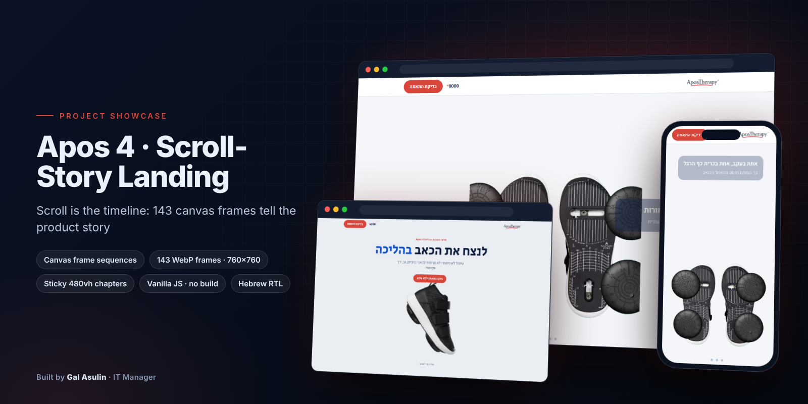</a></p>

<div align="center">

# Apos 4 · Scroll-Story Landing Page

**A launch page for a medical walking system where the scroll bar is the timeline: 143 canvas frames turn the shoe and take its pods apart and back together.**

🇬🇧 English · 🇮🇱 [עברית](README.he.md)

[](https://galasulin.github.io/apos4-scroll-landing/)


<br>


[Live demo](https://galasulin.github.io/apos4-scroll-landing/) · [Screens](#screens) · [Architecture](#architecture) · [Tech](#technical-parameters)

<br>

<a href="https://galasulin.github.io/apos4-scroll-landing/">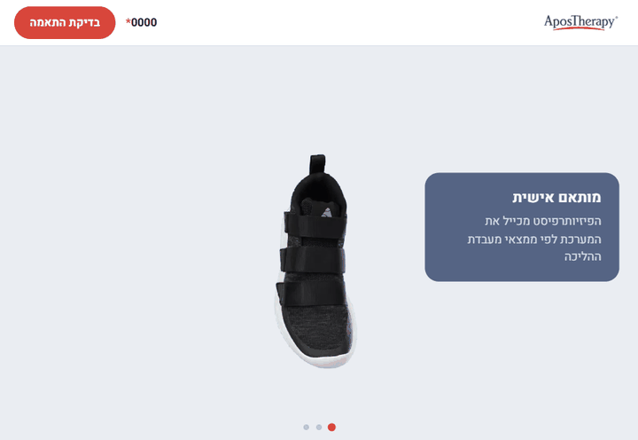</a>

<sub>Scroll slowly on the live page: the page is the animation.</sub>

</div>

> **Showcase repository.** A sanitized, static copy of a landing page that runs in production on the company's domain. The tag manager, the CRM lead endpoint, the third-party accessibility widget and every real phone number were removed. The form still validates, but it never sends anything: a valid submit only shows a demo notice. See [Privacy & scope](#privacy--scope).

## At a glance

| | |
|---|---|
| **Type** | Product launch / lead-generation landing page |
| **Status** | Live in production on the company domain · this repo is the sanitized copy |
| **Stack** | HTML5 · CSS · vanilla JavaScript · `<canvas>` · WebP |
| **My role** | Concept, design, front-end engineering, production wiring |
| **Live demo** | [galasulin.github.io/apos4-scroll-landing](https://galasulin.github.io/apos4-scroll-landing/) |
| **Languages** | UI in Hebrew (RTL) · docs in English and Hebrew |

## Screens

<table>
  <tr>
    <td width="33%"><a href="assets/desktop-hero.png">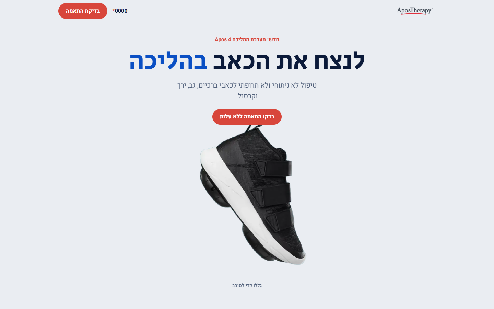</a><br><sub><b>Hero</b> · first frame of the turn under the headline</sub></td>
    <td width="33%"><a href="assets/scroll-1-attached.png">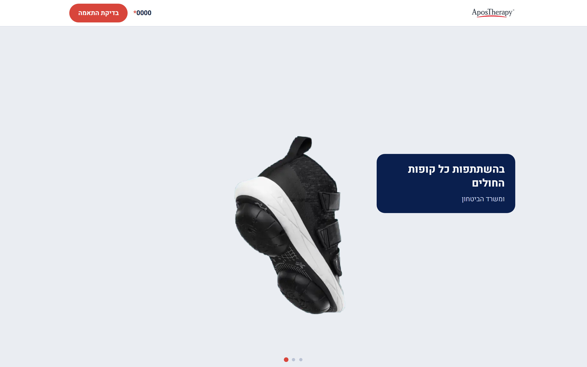</a><br><sub><b>1 · The turn</b> · shoe mid-rotation, last beat on screen</sub></td>
    <td width="33%"><a href="assets/scroll-2-detached.png">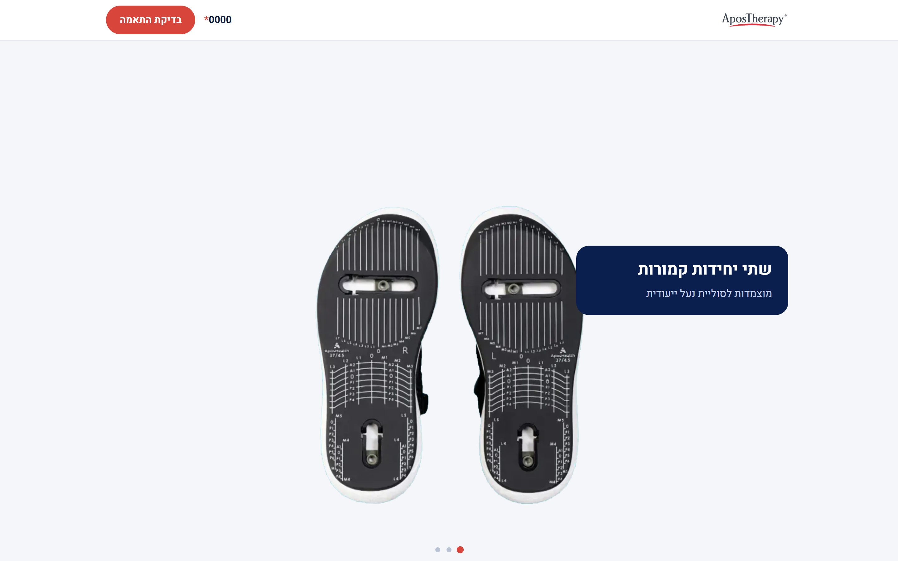</a><br><sub><b>2 · Apart</b> · bare sole and calibration grid</sub></td>
  </tr>
  <tr>
    <td width="33%"><a href="assets/scroll-3-snapping.png">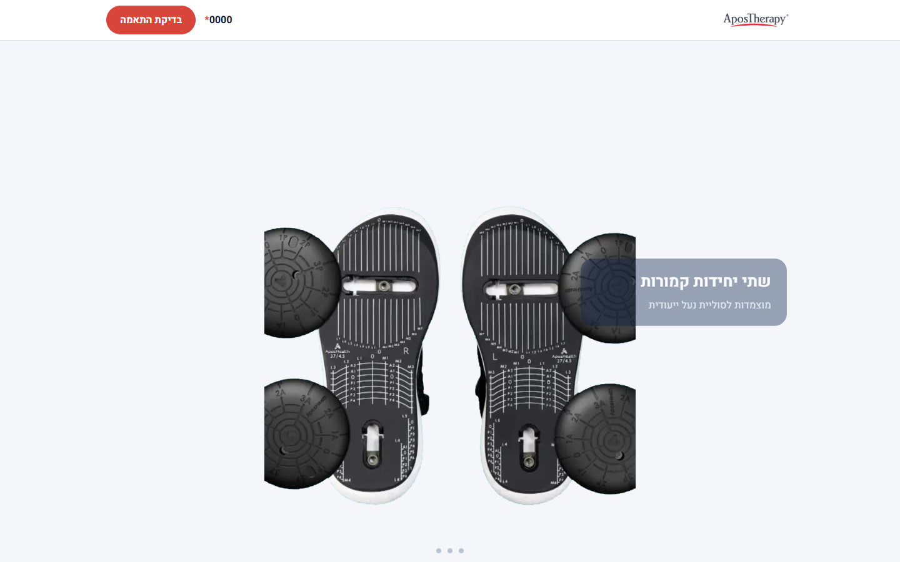</a><br><sub><b>3 · Coming together</b> · pods fly in from the sides</sub></td>
    <td width="33%"><a href="assets/scroll-4-reattached.png">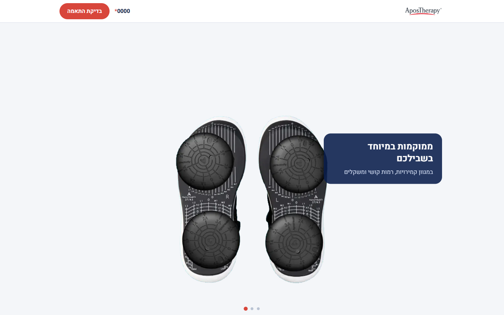</a><br><sub><b>4 · Snapped back</b> · all four pods on, last beat</sub></td>
    <td width="33%"><a href="assets/desktop-proof.png">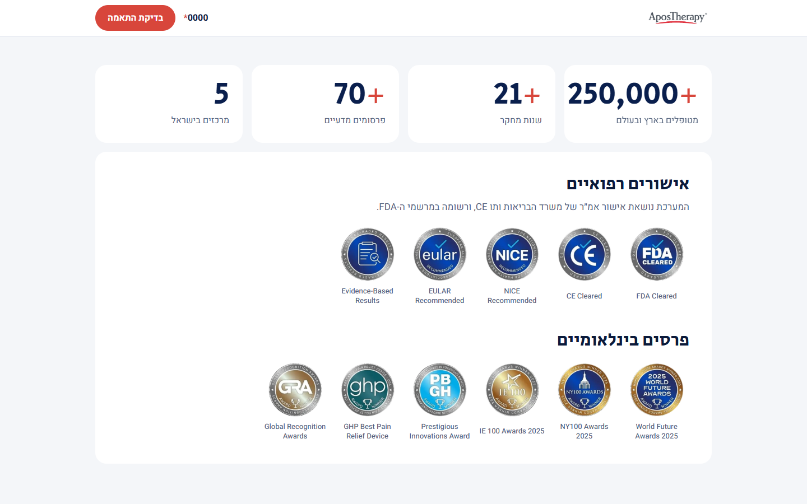</a><br><sub><b>Proof</b> · counters, approvals, award badges</sub></td>
  </tr>
  <tr>
    <td width="33%"><a href="assets/desktop-form-demo.png">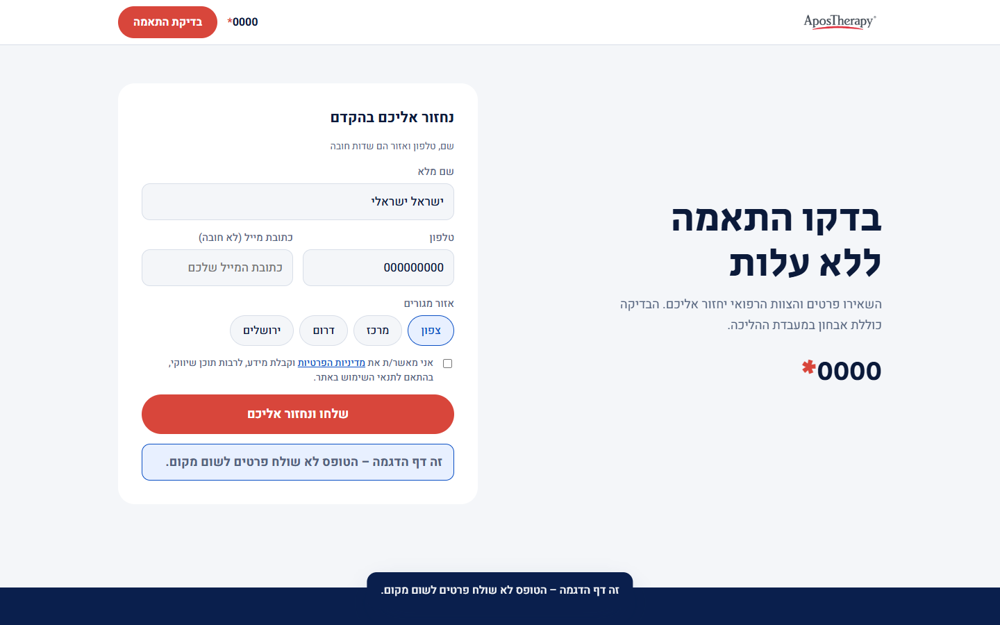</a><br><sub><b>Form (demo)</b> · production validation, no sending</sub></td>
    <td width="33%" align="center"><a href="assets/mobile.png">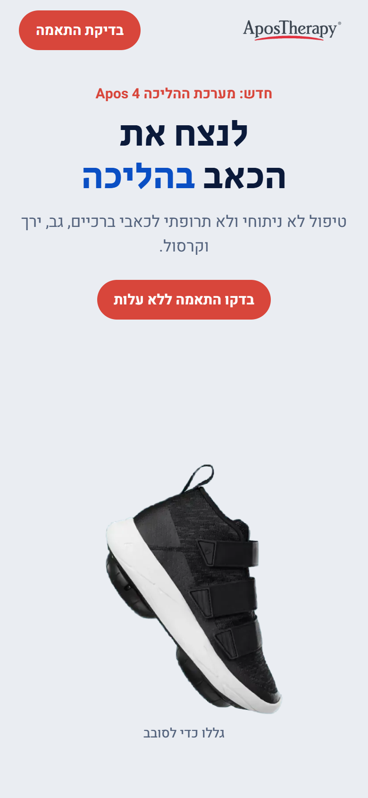</a><br><sub><b>Mobile</b> · hero</sub></td>
    <td width="33%" align="center"><a href="assets/mobile-pods.png">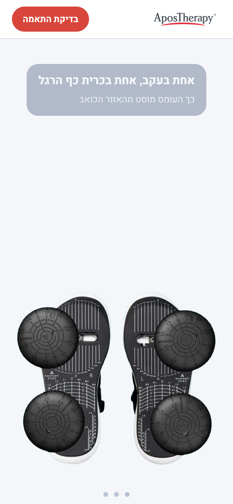</a><br><sub><b>Mobile</b> · pods chapter, captions above the shoe</sub></td>
  </tr>
</table>

## What it is

The launch page for **Apos 4**, the new generation of the AposTherapy walking system: a shoe with two convex pods under each sole that shift load away from a painful joint. The product story is *what is under the foot*, so the page tells it with the product instead of with paragraphs.

You scroll and the page plays back like a film you control. The shoe makes a full turn. The camera tips to the sole, the pods are gone, and the bare calibration grid shows. Keep scrolling and four pods fly in and click on, one heel pod and one forefoot pod per shoe. Scroll back up and they come off again. Then a sticky "how it works" sequence, proof, the two versions, and one lead form.

## Key capabilities

**Scroll storytelling**
- Two pinned chapters (`#ch-rotate`, `#ch-pods`), each `480vh` tall with a `position: sticky` stage of `100svh`. The browser scrolls normally: no scroll-jacking, no wheel hijack.
- Chapter 1: a full turn of the shoe, 56 frames. Three beats beside it: personal calibration, at home in your routine, covered by every health fund.
- Chapter 2: the sole, 87 frames. The pods come off, the grid shows, the pods fly back in. Scrolling up reverses it.

**Frame-sequence renderer**
- Transparent 760 × 760 WebP frames drawn to a 760 × 760 `<canvas>`.
- Load order: frame 1 is `<link rel="preload" fetchpriority="high">`; first and last frames load at once; after 300 ms every 4th frame, then the rest. The sequence is scrubbable almost immediately.
- If a frame is not decoded yet, the nearest loaded frame is drawn, so the canvas never goes blank.

**Motion without a library**
- Displayed progress eases toward real scroll progress (`cur += (target - cur) * 0.12`) inside a `requestAnimationFrame` loop that runs only while something still moves, then stops.
- Every caption declares its slice of the chapter (`data-range="0.30 0.55"`). One function fades, scales and slides all of them from one progress value; a dot rail marks the active beat.
- Captions are placed from the shoe outward (`--shoe`, `--beside` custom properties), not from the screen edges. On mobile they move above the shoe.

**Content sections**
- "How it works": a sticky photo that cross-fades as each step crosses the middle of the viewport (`IntersectionObserver`, `rootMargin: -45% 0px -45% 0px`). Below 860 px the photo moves inline into each step.
- Proof: four count-up numbers, 5 medical-approval badges and 6 award badges.
- Two versions (laces / velcro) and an exploded view of the parts.

**Form and accessibility**
- Labels, `fieldset` / `legend` for the region, `aria-invalid` + `aria-describedby` errors, focus moves to the first invalid field, optional email, hidden honeypot field, 44 px touch targets.
- Skip link to the form, visible `:focus-visible` ring, `role="img"` + `aria-label` on both canvases, safe-area insets for notched phones.
- `prefers-reduced-motion`: chapters collapse to normal height, canvases show the end state (pods attached), all captions are visible, reveals and counters are static.

## Architecture

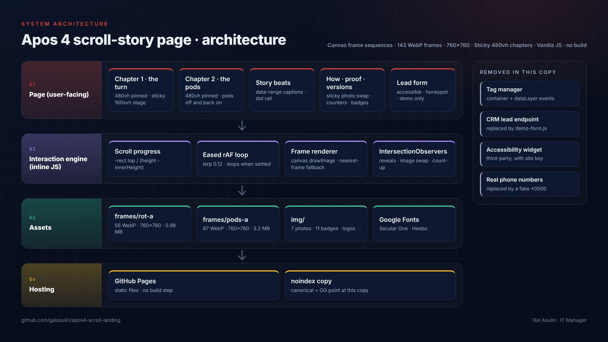

The page is one static `index.html` with inline CSS and an inline engine script, plus a small `demo-form.js`. There is no framework and no build step. A scroll or resize event only "kicks" a `requestAnimationFrame` loop. Each tick reads the progress of both pinned chapters from `getBoundingClientRect()`, eases toward it, maps it to a frame index per sequence, and drives every caption that declares a `data-range`. A separate set of `IntersectionObserver`s handles the ordinary sections: reveals, the sticky image swap and the counters. Assets are plain files served by GitHub Pages; the only external host is Google Fonts.

### Flow

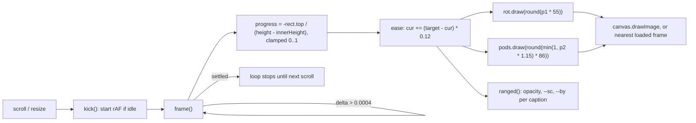

## Technical parameters

| Parameter | Value |
|---|---|
| Page shell | `index.html` 39,499 B (markup, inline CSS, inline engine) · `demo-form.js` 3,843 B · `accessibility.html` 4,612 B |
| Turn sequence (`frames/rot-a/`) | 56 frames · WebP with alpha · 760 × 760 px · 978,672 B total (avg 17.5 KB) |
| Pods sequence (`frames/pods-a/`) | 87 frames · WebP with alpha · 760 × 760 px · 3,212,190 B total (avg 36.9 KB) |
| All frames | 143 frames · 4,190,862 B (about 4.0 MiB) |
| First-party page weight | 4,944,779 B (about 4.7 MiB): HTML, form script, favicon, all frames, photos, badges, logos; 85% of it is frames. Fonts and the share image not counted |
| Photos and badges (`img/`) | 7 WebP photos 1500 to 1800 px wide · 11 badge WebP 240 × 240 shown at 96 px (80 px at ≤ 520 px) · 2 PNG logos · 1200 × 630 JPEG share image |
| Pinned chapters | 2 × `480vh` · sticky stage `100vh` / `100svh` · canvas size `min(88vw, 66svh)` (`min(92vw, 52svh)` at ≤ 760 px) |
| Scroll easing | lerp factor 0.12 per frame · stop threshold 0.0004 · pods sequence completes at 87% of its chapter (`p × 1.15`) |
| Caption fades | per-caption `data-range` · 0.09-progress fade in and out · scale 0.95 → 1 · 30 px slide |
| Counters | 4 values · 1,400 ms ease-out-cubic · start at 30% visibility · `toLocaleString('en-US')` |
| Reveal observer | threshold 0.15 · 70 ms stagger steps |
| Breakpoints | 520 · 700 · 760 / 761 · 860 px |
| Fonts | Secular One (display) · Heebo 300 / 400 / 500 / 700 / 800 (body) · Google Fonts with `display=swap` |
| External hosts | `fonts.googleapis.com`, `fonts.gstatic.com` only |
| Dependencies / build | none / none |
| SEO in this copy | `noindex`, canonical and Open Graph pointed at the GitHub Pages copy |

## Engineering decisions

- **Frame sequence on canvas, not video or WebGL** → each frame is a pre-rendered image of the real 3D model, so it looks exactly like the product and scrubs both ways with no seeking lag. Trade-off: about 4 MiB of frames, handled by the progressive load order.
- **Native scroll + sticky, not scroll-jacking** → the browser keeps normal scrolling, keyboard and accessibility behaviour; progress is just a number read from layout. Trade-off: chapter length is set in `vh`, so pacing is tuned by hand (`480vh`).
- **Idle-stopping rAF loop** → the loop runs only while eased progress still differs from the target, so a still page costs nothing. Trade-off: one more state flag (`running`).
- **Nearest-frame fallback** → a fast scroll before all frames arrive still shows a close frame instead of a blank canvas.
- **Captions positioned from the shoe** → `--shoe` and `--beside` keep beats next to the product at any width, instead of drifting to the screen edges on wide monitors.
- **End state for reduced motion** → users who ask for less motion get the finished picture (pods attached) and all the text, not a frozen first frame.

## Status and my role

**Live in production on the company domain.** This repo is a sanitized portfolio copy: tracking removed, form disconnected, phone numbers replaced with a fake `*0000` that only shows a demo notice. It is marked `noindex` so it never competes with the live page in search.

I designed and built the page end to end: the scroll-story concept and chapter structure, the frame-sequence and progress engine, layout and copy placement, responsive and reduced-motion behaviour, the accessible lead form, and its tracking / CRM wiring in production. In production it is a PHP page on the company domain; this copy is static.

## Repository layout

```
apos4-scroll-landing/
├── index.html          page: markup, inline CSS, scroll + frame-sequence engine
├── demo-form.js        demo form: production validation, no network request
├── accessibility.html  short demo accessibility page
├── favicon.svg
├── frames/
│   ├── rot-a/          01.webp … 56.webp   the turn
│   └── pods-a/         01.webp … 87.webp   pods off and back on
├── img/                logos, product photos, share image
│   └── badges/         11 approval and award badges
├── assets/             README screenshots and the animated preview
└── LICENSE
```

## Privacy & scope

| Removed / replaced | How |
|---|---|
| Tag manager container + `noscript` iframe, all `dataLayer` events | Removed |
| CRM lead endpoint, form keys, UTM / source passthrough | Replaced by `demo-form.js`: same validation, no network request |
| Call-centre star number in the header, lead block and footer | Replaced by a fake, non-dialable `*0000` (no `tel:` link) that shows a demo notice |
| "Call us" text in the form's error message | Removed |
| Third-party accessibility widget (with its site key) | Removed; a short demo accessibility page lists what the page itself does |
| Accessibility statement with staff contact details | Not copied; replaced by `accessibility.html` without personal details |
| Names of the system's developers | Replaced with neutral copy |
| Structured data (with the company phone) | Removed |
| Canonical / Open Graph URLs | Pointed at this GitHub Pages copy; page marked `noindex` |
| Outbound links to the company site (privacy, contact, branches, FAQ) | Disabled; they show a demo notice |
| `robots.txt`, `sitemap.xml`, `404.html`, server config | Not copied |
| Image metadata (EXIF / XMP / text chunks) | Stripped from every image |

The only external hosts the page loads are **Google Fonts** (`fonts.googleapis.com`, `fonts.gstatic.com`).

The AposTherapy / APOS names, logos and product photos belong to their owner and are shown with permission, for portfolio purposes only. View-only portfolio, see [LICENSE](LICENSE).

---

<div align="center"><b>Built by <a href="https://github.com/galasulin">Gal Asulin</a>, IT Manager</b></div>

<div align="center"><sub>Landing pages in this portfolio: <a href="https://github.com/galasulin/apos4-scroll-landing">apos4-scroll-landing</a> · <a href="https://github.com/galasulin/apos4-pods-landing">apos4-pods-landing</a> · <a href="https://github.com/galasulin/apostherapy-research-landing">apostherapy-research-landing</a></sub></div>
