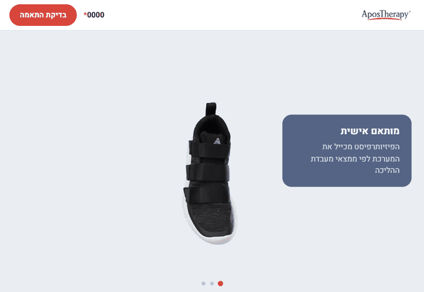
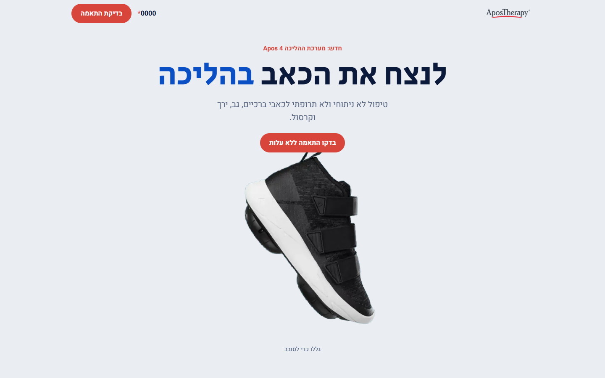
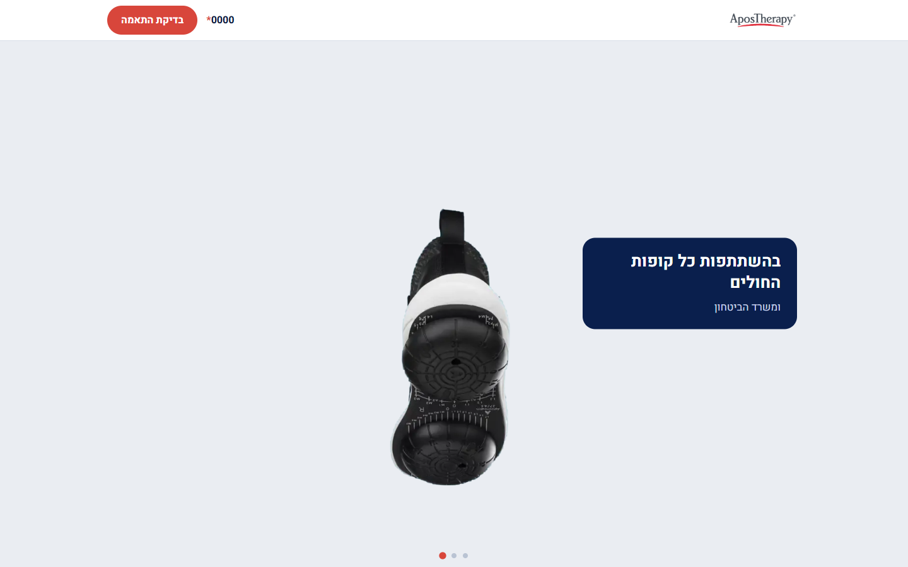
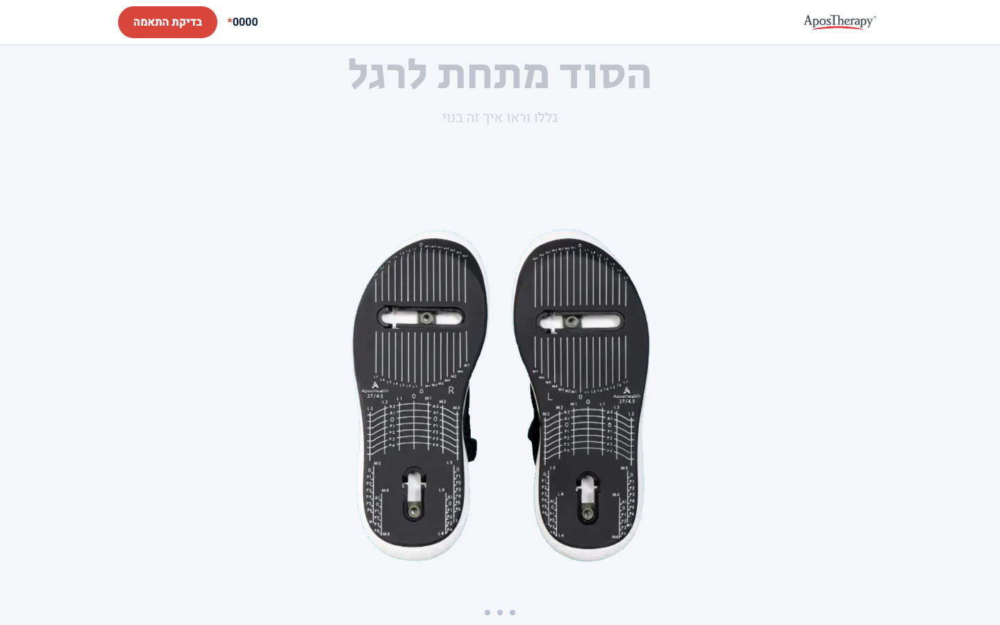
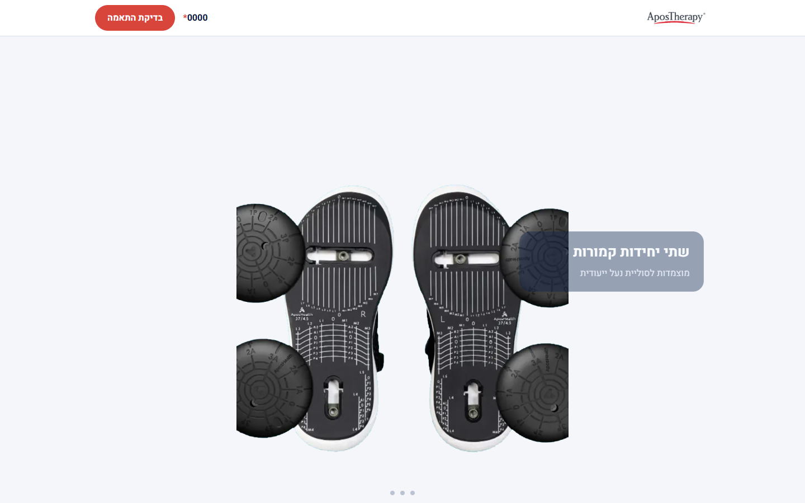
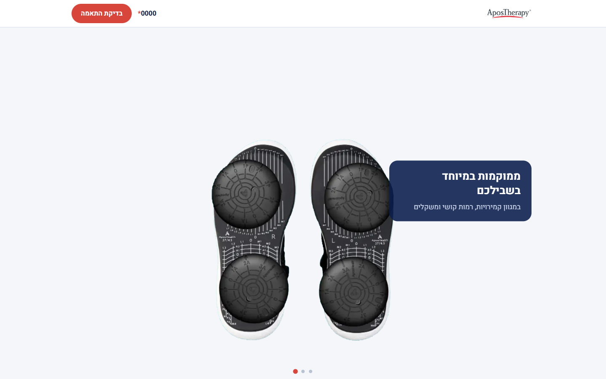
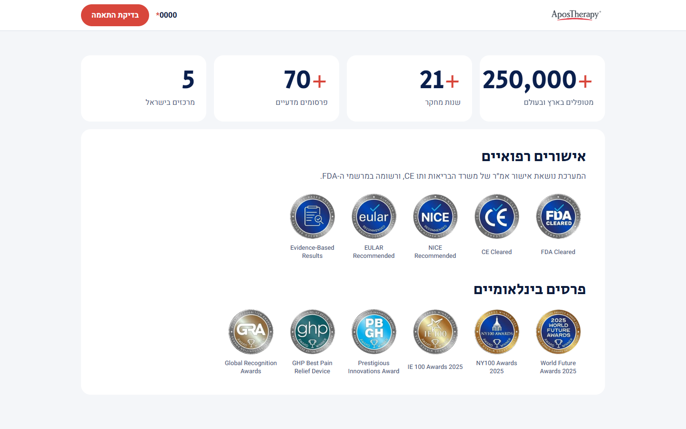
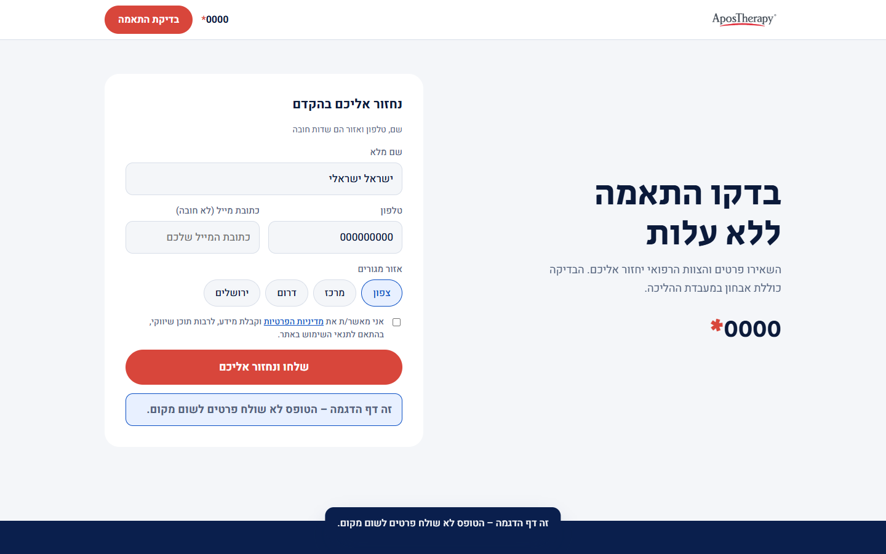
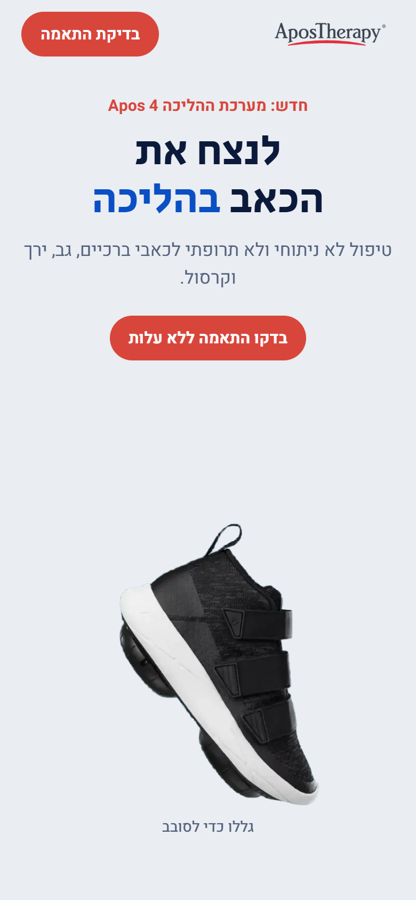
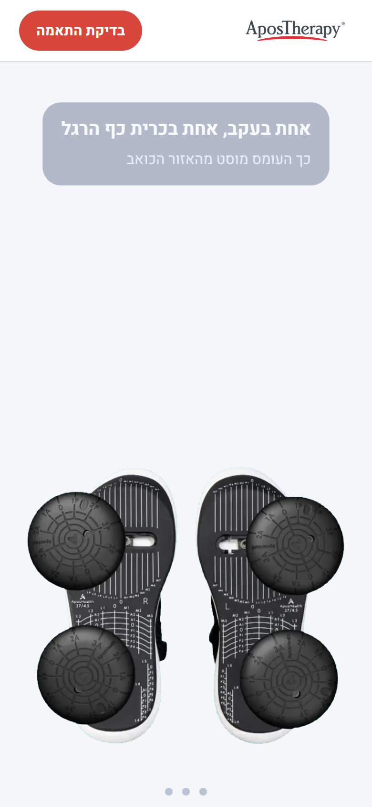

### Apos 4 · a scroll-driven product story for a medical walking system

*Pinned scroll chapters · canvas frame sequences · the system comes apart and snaps back together · Hebrew RTL · zero dependencies*

 

**[▶ Open the live demo](https://galasulin.github.io/apos4-scroll-landing/)** · *scroll slowly, the page is the animation*

🇮🇱 [**גרסה עברית מלאה**](README.he.md)

> **Showcase repository.** This is a sanitized, static copy of a landing page that runs in production on the company's domain. The tag manager, the CRM lead endpoint, the third-party accessibility widget and every real phone number were removed. The form still validates, but it never sends anything: a valid submit only shows a demo notice. See [Privacy / what was removed](#-privacy--what-was-removed).

---

## 📖 What it is

The launch page for **Apos 4**, the new generation of the AposTherapy walking system: a shoe with two convex pods under the sole that shift load away from a painful joint. The product's whole story is *what is under the foot*, so the page tells it with the product itself instead of with paragraphs.

You scroll, and the page plays back like a film you control:

1. **The shoe turns.** A full 360° turn of the shoe, frame by frame, tied to scroll position. Three short "beats" fade in beside the shoe: personal calibration, at home in your routine, covered by every health fund.
2. **The system comes apart and snaps back together.** The camera tips to the sole, the pods are gone and you see the bare calibration grid. Keep scrolling and the four pods fly in from the sides and click onto the sole, one heel pod and one forefoot pod per shoe. Scroll back up and they come off again.
3. **How it works**: a sticky photo that cross-fades as each step scrolls past.
4. **Proof**: animated counters, medical approvals and international award badges.
5. **Two versions** (laces / velcro) and the parts, then a single lead form.

## ✨ What is special about it

| | |
|---|---|
| **Scroll is the timeline** | Each chapter is a tall section (`480vh`) with a `position: sticky` stage. Progress is `-rect.top / (height - innerHeight)`, clamped to 0..1, and maps straight to a frame index. No scroll-jacking: the browser scrolls normally. |
| **Canvas frame sequences** | 56 frames for the turn and 87 frames for the pods, transparent 760×760 WebP, drawn to a `<canvas>`. The first and last frames load first, then every 4th frame, then the rest, so the sequence is scrubbable almost immediately. If a frame isn't loaded yet, the nearest loaded frame is drawn, so the canvas never goes blank. |
| **Inertia without a library** | The displayed progress eases toward the real scroll position (`cur += (target - cur) * 0.12`) inside a `requestAnimationFrame` loop that runs only while something is still moving, then stops. |
| **Story beats on a range** | Every caption declares the slice of the chapter where it lives (`data-range="0.30 0.55"`). One function fades, scales and slides all of them from the same progress value, and a dot rail shows which beat is active. |
| **Layout from the shoe outward** | The captions are positioned relative to the shoe's size (`--shoe`, `--beside` custom properties), not the screen edges, so they sit beside the product at every width; on mobile they move above it. |
| **Reduced motion** | With `prefers-reduced-motion`, the chapters collapse to normal height, the canvases show the end state (pods attached) and all captions are simply visible. |
| **Accessible form** | Labels, `fieldset`/`legend` for the region, `aria-invalid` + `aria-describedby` errors, focus moves to the first invalid field, optional email, a hidden honeypot for bots, 44 px touch targets. |
| **Light** | One HTML file with inline CSS and JS, one small form script, no framework and no build step. |

## 🖥️ Screenshots

<table>
  <tr>
    <td width="50%"> <b>Hero</b> · the first frame of the turn under the headline.</td>
    <td width="50%"> <b>1 · Attached</b> · the shoe has turned to show the sole, pods on.</td>
  </tr>
  <tr>
    <td width="50%"> <b>2 · Apart</b> · the sole chapter starts with the pods off: the bare calibration grid.</td>
    <td width="50%"> <b>3 · Coming together</b> · the pods fly in from the sides as you scroll.</td>
  </tr>
  <tr>
    <td width="50%"> <b>4 · Snapped back</b> · all four pods are on, the last beat explains the calibration.</td>
    <td width="50%"> <b>Proof</b> · counters, medical approvals and award badges.</td>
  </tr>
  <tr>
    <td width="50%"> <b>Form (demo)</b> · validates like production; a valid submit only shows the demo notice.</td>
    <td width="50%">
        <b>Mobile</b> · hero and the pods chapter; captions move above the shoe.
    </td>
  </tr>
</table>

## 🛠️ Stack

- **HTML5 + CSS** (custom properties, `position: sticky`, `clamp()` typography, `svh` units, safe-area insets) with **Secular One** + **Heebo** from Google Fonts.
- **Vanilla JavaScript**: a frame-sequence renderer on `<canvas>`, a scroll-progress engine with eased playback, `IntersectionObserver` reveals, a sticky image swap and count-up numbers.
- **WebP** frame sequences rendered from the product's 3D model.
- In production: a PHP page served from the company domain, wired to a tag manager and to a CRM lead endpoint (both removed here).

## 👤 My role

I designed and built this page end to end: the scroll-story concept and chapter structure, the frame-sequence and progress engine, the layout and copy placement, the responsive and reduced-motion behaviour, the accessible lead form and its tracking/CRM wiring in production.

## 📌 Status

**Live in production on the company domain.** This repo is a sanitized portfolio copy: tracking removed, form disconnected, phone numbers replaced with a fake `*0000` that only shows a demo notice. It is marked `noindex` so it never competes with the live page in search. An earlier prototype of the same idea was built before this version and is not published.

## 🔒 Privacy / what was removed

| Removed / replaced | How |
|---|---|
| Tag manager container + `noscript` iframe, all `dataLayer` events | Removed |
| CRM lead endpoint, form keys, UTM / source passthrough | Replaced by `demo-form.js`: same validation, no network request |
| Call-centre star number in the header, lead block and footer | Replaced by a fake, non-dialable `*0000` (no `tel:` link) that shows a demo notice |
| "Call us" text in the form's error message | Removed |
| Third-party accessibility widget (with its site key) | Removed; a short demo accessibility page lists what the page itself does |
| Accessibility statement with staff contact details | Not copied; replaced by `accessibility.html` without personal details |
| Names of the system's developers | Replaced with neutral copy |
| Structured data (with the company phone) | Removed |
| Canonical / Open Graph URLs | Pointed at this GitHub Pages copy; page marked `noindex` |
| Outbound links to the company site (privacy, contact, branches, FAQ) | Disabled; they show a demo notice |
| `robots.txt`, `sitemap.xml`, `404.html`, server config | Not copied |
| Image metadata (EXIF / XMP / text chunks) | Stripped from every image |

The only external hosts the page loads are **Google Fonts** (`fonts.googleapis.com`, `fonts.gstatic.com`).

## 📂 In this repository

| Path | What |
|---|---|
| [`index.html`](index.html) | The page: markup, inline CSS and the scroll / frame-sequence engine |
| [`demo-form.js`](demo-form.js) | Demo form: production validation, no sending |
| [`accessibility.html`](accessibility.html) | Short demo accessibility page |
| [`frames/`](frames) | `rot-a/` 56 frames of the turn · `pods-a/` 87 frames of the pods |
| [`img/`](img) | Logos, product photos, badges, share image |
| [`assets/`](assets) | README screenshots and the animated preview |

---

**Built by [Gal Asulin](https://github.com/galasulin), IT Manager**

More landing pages: <a href="https://github.com/galasulin/apostherapy-lead-landing">apostherapy-lead-landing</a> · <a href="https://github.com/galasulin/apostherapy-research-landing">apostherapy-research-landing</a> · <a href="https://github.com/galasulin/apostherapy-case-study">apostherapy-case-study</a> 
© 2026 Gal Asulin · view-only portfolio, see <a href="LICENSE">LICENSE</a>

